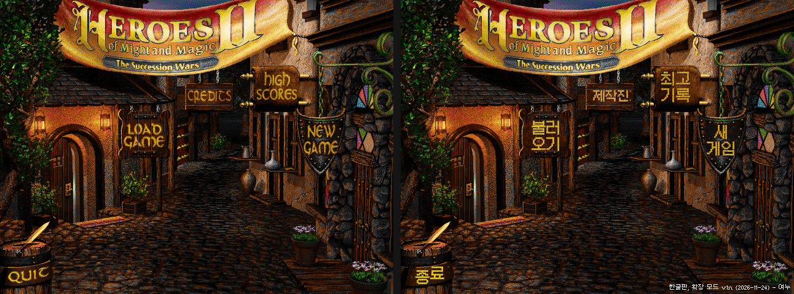
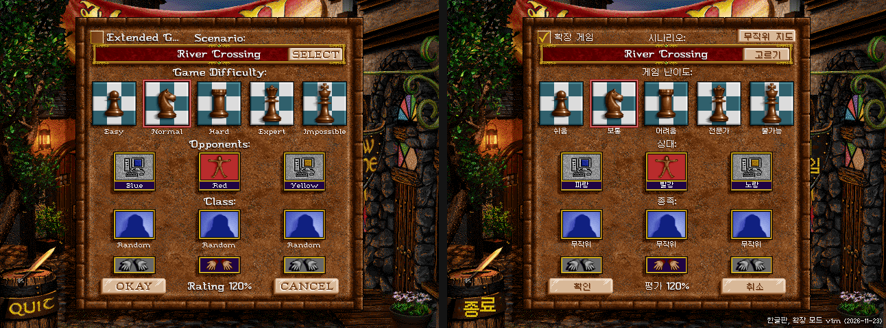
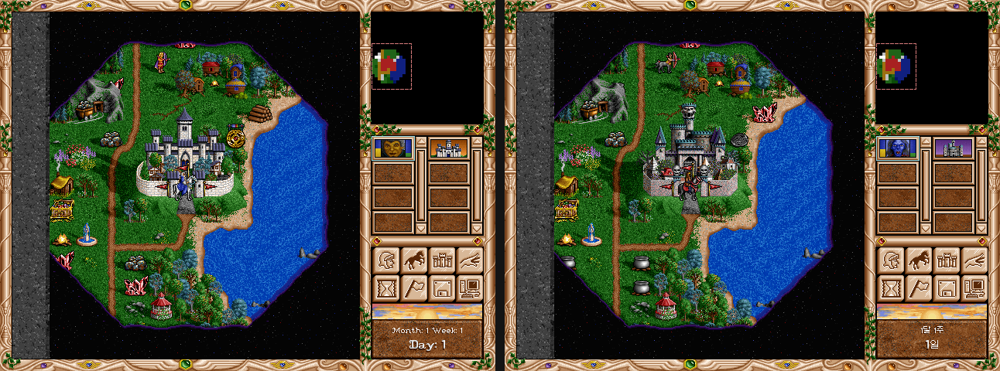
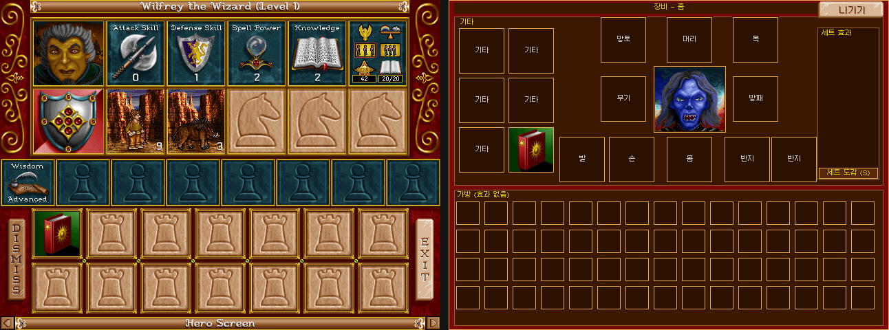
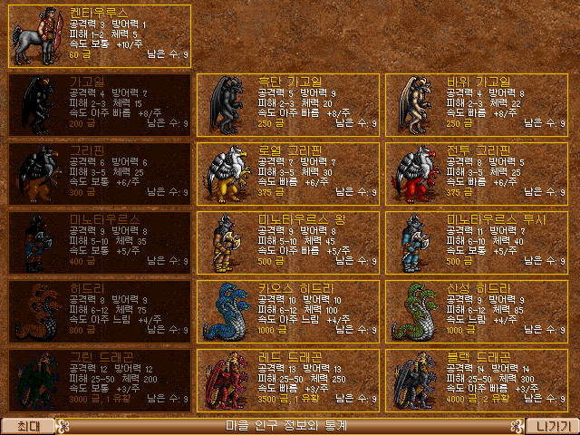
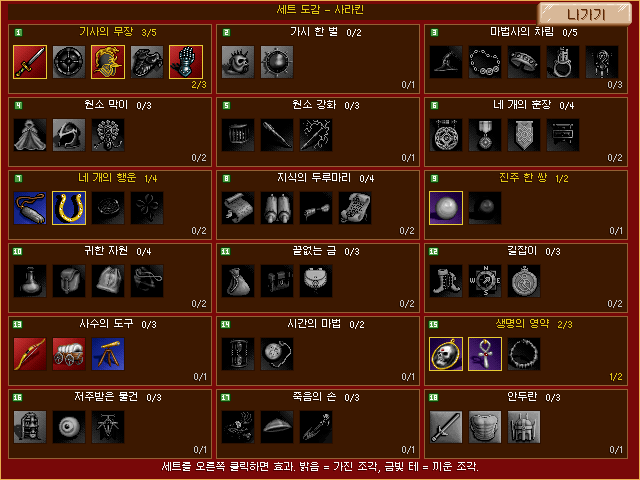
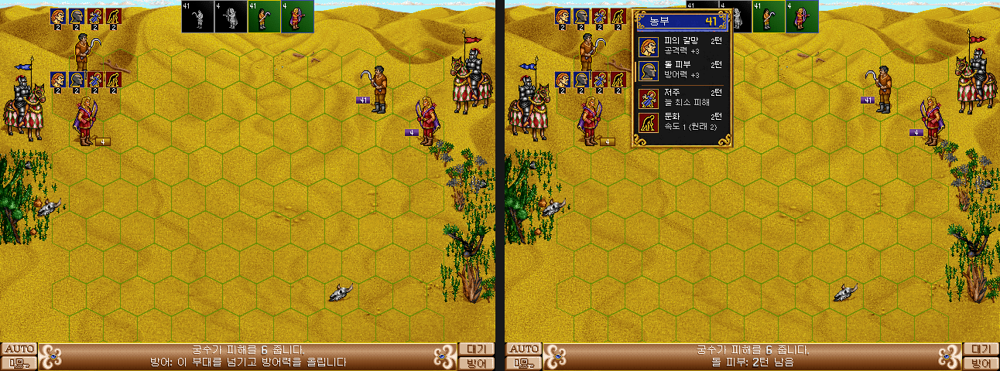
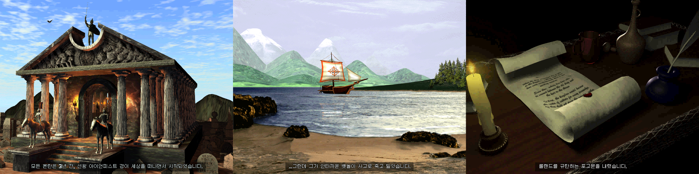
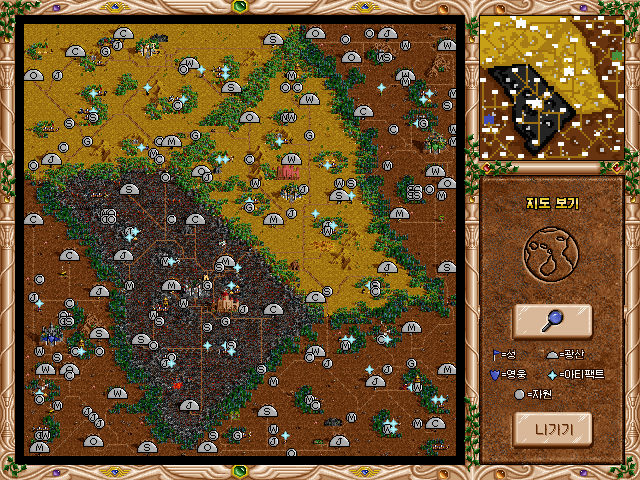

# 히마메2 한글 확장판 (fheroes2-korean-ext)

**Heroes of Might and Magic II**(히어로즈 오브 마이트 앤 매직 2)를 한국어로 즐기고, 원작에 없던 **확장 모드**를 더한 판입니다.
오픈소스 엔진 [fheroes2](https://github.com/ihhub/fheroes2)를 고쳐서 만들었습니다.

- 만든 과정 (블로그): https://blog.naver.com/finepix401
- **원작 게임 파일은 들어 있지 않습니다.** 히어로즈 2 원작(정품)을 갖고 계셔야 합니다.

## 원작과 비교 (왼쪽 원작 / 오른쪽 이 판)

**주 메뉴**


**시나리오 창** — 왼쪽 위 "확장 게임" 칸을 켜면 확장 모드, 끄면 원작 그대로. 켜면 "무작위 지도" 버튼도 생깁니다.


**모험 화면**


**영웅 화면 → 3편식 장비 창** — 끼운 아이템만 효과가 납니다.


## 새로 생긴 것

**우물: 등급마다 기본 | 갈래 1 | 갈래 2** — 업그레이드 건물을 지으면 두 갈래 중 하나를 골라 고용


**세트 도감** — 가진 조각은 밝게, 끼운 조각은 금빛 테


**전투: 대기·방어, 다음 차례 표시, 유닛 머리 위 마법 표시** — 파랑은 이로운 마법, 빨강은 해로운 마법, 숫자는 남은 턴. 마우스를 대면 전체 목록


**캠페인 동영상 한글 자막** — 장면 색에 맞춘 글자와 어두운 띠


**무작위 지도** — 광산·건물·자원을 원래보다 더 채움


## 무엇이 들어 있나

### 한국어
- 게임 안 문장 전체 (엔진 문장 3,289줄, 원작 지도·캠페인 글)
- 이름 뒤 조사(이/가, 을/를 …)를 받침에 맞게
- 캠페인 동영상 한글 자막 (178줄)
- 주 메뉴 간판, 최고 기록, 캠페인 화면 등 그림 속 글자 (아래 "그림 속 한글 만들기"로 직접 만듭니다)
- 한글 글꼴: [갈무리](https://github.com/quiple/galmuri) (SIL OFL 1.1)

### 확장 모드 (새 게임의 시나리오 창에서 "확장 게임" 칸을 켰을 때만)
- 모든 종족 2~6단계에 **갈래 업그레이드** (새 크리처 39종, 크리처마다 특수 능력)
- 우물에서 등급별로 바로 고르고 고용
- **3편식 부위 착용** (머리, 목, 망토, 무기, 방패, 몸, 손, 발, 반지 2, 기타 5)과 **세트 19종**, 세트 도감
- 무작위 지도 만들기 (광산·건물·자원을 더 채움, 새 크리처 뱅크)
- 전투: 대기, 방어, 다음 차례 표시, 유닛 머리 위 마법 표시
- 확장 게임 칸을 끄면 원작 그대로입니다. 캠페인도 원작 그대로입니다.

## 설치 (윈도우)

1. [Releases](../../releases)에서 가장 최근 `fheroes2-korean-ext_win_….zip`을 받아 압축을 풉니다.
2. 원작 히어로즈 2 설치 폴더에서 아래를 같은 폴더에 복사합니다.
   - `DATA` 폴더 → `data` (HEROES2.AGG 등)
   - `MAPS` 폴더 → `maps`
   - 동영상 자막을 보려면 `ANIM` 폴더도 → `ANIM`
3. `fheroes2.exe`를 실행합니다. `h2` 폴더가 있으면 한글이 저절로 켜집니다.

원작 파일을 어디서 어떻게 넣는지는 fheroes2 안내([README_fheroes2.md](README_fheroes2.md))와 같습니다.

## 그림 속 한글 만들기 (선택)

주 메뉴 간판, 최고 기록, 캠페인 화면처럼 그림에 새겨진 글자는 원작 그림을 바탕으로 만들어서 이 저장소에 넣지 않았습니다.
갖고 계신 원작 파일로 직접 만들 수 있습니다. (Python 3, `pip install pillow numpy opencv-python`)

```
python korean/tools/make_menu_signs.py <게임폴더>/data/HEROES2.AGG <갈무리 dist 폴더> <게임폴더>/h2/ko/BTNSHNGL.ICN
python korean/tools/make_ko_titles.py  <게임폴더>/data/HEROES2.AGG <갈무리 dist 폴더> <게임폴더>/h2/ko
```

갈무리 글꼴은 https://github.com/quiple/galmuri 에서 받습니다 (2.40.3으로 만들었습니다). 없어도 게임은 한글로 돌아가고, 그 그림들만 영어로 남습니다.

## 폴더

| 폴더 | 내용 |
| --- | --- |
| `src/` | 엔진 소스. 확장 모드는 `src/fheroes2/h2ext/`, 고친 곳에는 `H2-EXT`, `H2-KOREAN` 표시 |
| `h2/` | 게임이 읽는 한글 파일 (번역 `KOREAN_H2.TXT`, 자막 `KOREAN_SUBS.TXT`, 글꼴 `HANGUL.BIN`) |
| `korean/catalog/` | 번역 목록 (영어 원문 ⇥ 한국어). `make_korean_h2.py`로 `h2/KOREAN_H2.TXT`를 만듭니다 |
| `korean/tools/` | 글꼴·그림 속 한글을 만드는 도구 |

엔진 안에는 히어로즈 1을 이 엔진으로 옮긴 코드(`src/fheroes2/h1/`)도 들어 있습니다. 히어로즈 1 원작 파일이 없으면 쓰이지 않습니다.

## 빌드

fheroes2와 같습니다 ([docs](docs)). 리눅스 예:

```
cmake -B build -DCMAKE_BUILD_TYPE=Release
cmake --build build -j
```

## 만든 사람 / 라이선스

- 기획·확인: 여누 ([블로그](https://blog.naver.com/finepix401)), 코드·번역 작업은 AI(Claude)와 함께
- 전투 마법 표시 그림: 쭈형
- 엔진: [fheroes2](https://github.com/ihhub/fheroes2) 팀 — GPL-2.0 ([LICENSE](LICENSE))
- 이 저장소의 코드도 GPL-2.0을 따릅니다. 갈무리 글꼴은 SIL OFL 1.1 ([korean/fonts](korean/fonts))
- Heroes of Might and Magic은 Ubisoft의 상표입니다. 이 프로젝트는 비공식 팬 작업이며 원작 게임 파일을 포함하지 않습니다.
